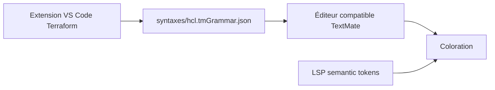

# hashicorp/syntax

> TextMate syntax-highlighting grammars for HCL, Terraform, Packer and Sentinel, for editor authors.

## The problem
Editors need a reliable, shared grammar to highlight HashiCorp configuration files.

## What it actually does
The repository contains TextMate grammars in JSON format, including `hcl.tmGrammar.json`. It recommends language identifiers (`hcl`, `terraform`, `terraform-vars`, `sentinel`). It specifies that the HCL grammar is for HCL languages that have no alternative, and that semantic highlighting via LSP comes as a complement.

## How it is wired
Simplified diagram based on the fiche, no diagram provided.



## Trying it
```bash
VERSION=0.1.0
URL="https://github.com/hashicorp/syntax/raw/v${VERSION}/syntaxes/hcl.tmGrammar.json"
curl -fL $URL > ./hcl.tmGrammar.json
```

## Cost and gotchas
Free. MPL-2.0 license, copyleft at the file level. The README says you normally do not need to use it directly.

## What it is not
Not a parser: a regex grammar does not understand a product's schema. It does not accept third-party grammars.

## Alternatives
mitchellh's tree-sitter-hcl, PrismJS and Rouge for other highlighting engines.

## For you
Ignore: you already benefit from it through editor extensions, with nothing to install yourself.
