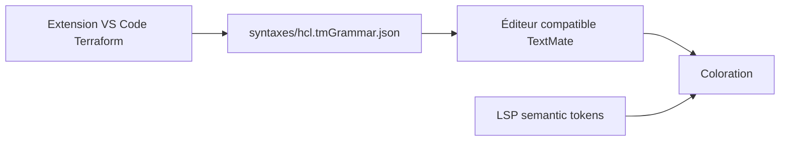

# hashicorp/syntax

> Grammaires TextMate de coloration syntaxique pour HCL, Terraform, Packer et Sentinel, pour auteurs d'éditeurs.

## Le problème
Les éditeurs ont besoin d'une grammaire fiable et partagée pour colorer les fichiers de configuration HashiCorp.

## Ce que ça fait vraiment
Le dépôt contient des grammaires TextMate au format JSON, dont `hcl.tmGrammar.json`. Il recommande des identifiants de langage (`hcl`, `terraform`, `terraform-vars`, `sentinel`). Il précise que la grammaire HCL sert aux langages HCL sans alternative, et que la coloration sémantique via LSP vient en complément.

## Comment c'est branché
Schéma simplifié d'après la fiche, sans diagramme fourni.



## Essayer
```bash
VERSION=0.1.0
URL="https://github.com/hashicorp/syntax/raw/v${VERSION}/syntaxes/hcl.tmGrammar.json"
curl -fL $URL > ./hcl.tmGrammar.json
```

## Coût et pièges
Gratuit. Licence MPL-2.0, copyleft au niveau des fichiers. Le README dit qu'on n'a normalement pas à l'utiliser directement.

## Ce que ce n'est pas
Pas un analyseur : une grammaire par regex ne comprend pas le schéma d'un produit. Il n'accepte pas les grammaires de tiers.

## Alternatives
tree-sitter-hcl de mitchellh, PrismJS et Rouge pour d'autres moteurs de coloration.

## Pour toi
À ignorer : tu en profites déjà via les extensions d'éditeur, sans rien à installer toi-même.

