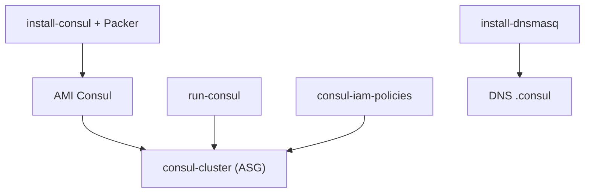

# hashicorp/terraform-aws-consul

> Terraform modules to deploy a Consul cluster on AWS; this repository is no longer supported.

## The problem
Setting up a Consul cluster (service discovery, key-value) on AWS by hand is slow and fragile.

## What it actually does
A set of modules: `install-consul` (Packer AMI), `consul-cluster` (Auto Scaling group), `run-consul` (startup scripts `--server` and `--client`), `install-dnsmasq` and `setup-systemd-resolved` for `.consul` DNS, as well as IAM and security group rules. The modules were created by Gruntwork with HashiCorp in 2017 and maintained until 2021.

## How it is wired
Simplified diagram based on the sheet, no diagram provided.

## Trying it
No command is documented as a block in the README: build an AMI with a Packer template, then deploy `consul-cluster` and run `run-consul` with `--server` or `--client` at startup.

## Cost and gotchas
Free, but the AWS infrastructure is billed. Do not use the public example AMIs in production. Repository archived, last push in January 2023, deprecated in 2022.

## What it is not
Not a supported solution: the README points to a newer repository without naming it. Not a Kubernetes deployment.

## Alternatives
No alternative named in the README.

## For you
Ignore: deprecated, archived and unrelated to data or AI.
