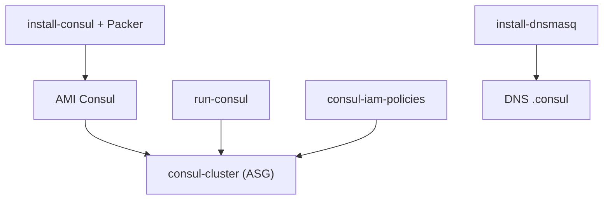

# hashicorp/terraform-aws-consul

> Modules Terraform pour déployer un cluster Consul sur AWS ; ce dépôt n'est plus supporté.

## Le problème
Monter un cluster Consul (découverte de services, clé-valeur) sur AWS à la main est long et fragile.

## Ce que ça fait vraiment
Un ensemble de modules : `install-consul` (AMI Packer), `consul-cluster` (groupe Auto Scaling), `run-consul` (scripts de démarrage `--server` et `--client`), `install-dnsmasq` et `setup-systemd-resolved` pour le DNS `.consul`, ainsi que les règles IAM et de groupes de sécurité. Les modules ont été créés par Gruntwork avec HashiCorp en 2017 et maintenus jusqu'en 2021.

## Comment c'est branché
Schéma simplifié d'après la fiche, sans diagramme fourni.

## Essayer
Aucune commande n'est documentée en bloc dans le README : construire une AMI avec un modèle Packer, puis déployer `consul-cluster` et lancer `run-consul` avec `--server` ou `--client` au démarrage.

## Coût et pièges
Gratuit, mais l'infrastructure AWS est facturée. Ne pas utiliser les AMI publiques d'exemple en production. Dépôt archivé, dernier push en janvier 2023, déprécié en 2022.

## Ce que ce n'est pas
Pas une solution supportée : le README renvoie vers un dépôt plus récent sans le nommer. Ce n'est pas un déploiement Kubernetes.

## Alternatives
Aucune alternative nommée dans le README.

## Pour toi
À ignorer : déprécié, archivé et sans lien avec la data ou l'IA.

