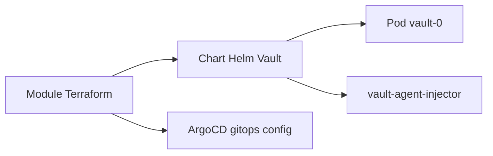

# hashicorp/terraform-aws-hashicorp-vault-eks-addon

> Terraform module that deploys HashiCorp Vault on an AWS EKS cluster, for platform teams.

## The problem
Storing and distributing secrets to Kubernetes workloads requires deploying and configuring Vault by hand.

## What it actually does
The module installs Vault on EKS via a Helm chart, configurable through `helm_config`. It can be managed via GitOps with ArgoCD (`manage_via_gitops`). After deployment, Vault must be initialized and then unsealed with at least three keys.

## How it is wired
Simplified diagram based on the sheet, no diagram provided.



## Trying it
```bash
kubectl exec -it vault-0 -n vault -- vault operator init
kubectl exec -it vault-0 -n vault -- vault operator unseal <key 1>
kubectl exec -it vault-0 -n vault -- vault operator unseal <key 2>
kubectl exec -it vault-0 -n vault -- vault operator unseal <key 3>
kubectl get pods -n vault | grep vault
```

## Cost and gotchas
You need an EKS cluster and therefore a billed AWS account. The unseal keys and the root token, shown only once, must be stored somewhere safe.

## What it is not
It is not a production-ready Vault configuration: the README says nothing about high availability or backup. It does not replace the Vault documentation.

## Alternatives
No alternative named in the README.

## For you
Worth watching: useful if your MLOps pipelines run on EKS and need centralized secrets, of no interest elsewhere.
