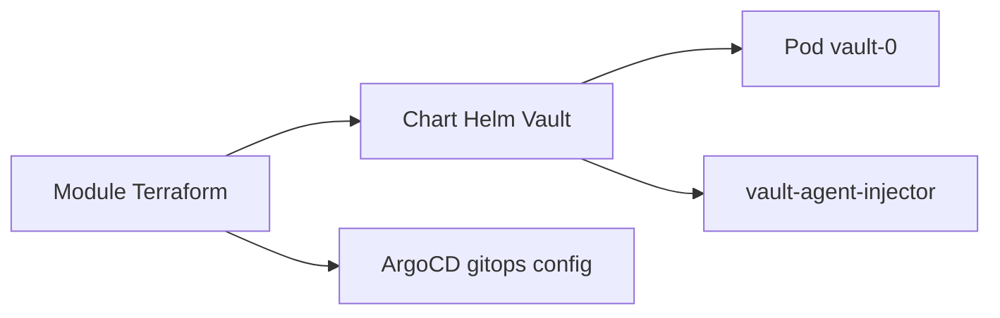

# hashicorp/terraform-aws-hashicorp-vault-eks-addon

> Module Terraform qui déploie HashiCorp Vault sur un cluster AWS EKS, pour les équipes plateforme.

## Le problème
Stocker et distribuer des secrets aux charges de travail Kubernetes demande de déployer et configurer Vault à la main.

## Ce que ça fait vraiment
Le module installe Vault sur EKS via un chart Helm, configurable par `helm_config`. Il peut être géré par GitOps avec ArgoCD (`manage_via_gitops`). Après le déploiement, il faut initialiser puis desceller Vault avec au moins trois clés.

## Comment c'est branché
Schéma simplifié d'après la fiche, sans diagramme fourni.



## Essayer
```bash
kubectl exec -it vault-0 -n vault -- vault operator init
kubectl exec -it vault-0 -n vault -- vault operator unseal <key 1>
kubectl exec -it vault-0 -n vault -- vault operator unseal <key 2>
kubectl exec -it vault-0 -n vault -- vault operator unseal <key 3>
kubectl get pods -n vault | grep vault
```

## Coût et pièges
Il faut un cluster EKS et donc un compte AWS facturé. Les clés de descellement et le jeton racine, affichés une seule fois, sont à conserver en lieu sûr.

## Ce que ce n'est pas
Ce n'est pas une configuration de Vault prête pour la production : le README ne parle ni de haute disponibilité ni de sauvegarde. Il ne remplace pas la documentation Vault.

## Alternatives
Aucune alternative nommée dans le README.

## Pour toi
À surveiller : utile si tes pipelines MLOps tournent sur EKS et ont besoin de secrets centralisés, sans intérêt ailleurs.

