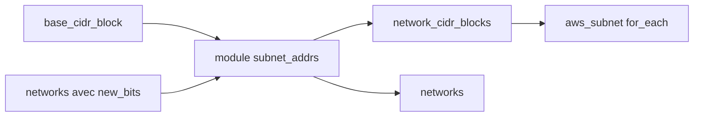

# hashicorp/terraform-cidr-subnets

> Terraform module that computes consecutive subnet ranges under a CIDR block, for cloud infrastructure.

## The problem
Splitting an address block by hand causes overlaps and accidental renumbering.

## What it actually does
You provide a `base_cidr_block` and a list of networks with `new_bits`. The module allocates consecutive blocks and returns `network_cidr_blocks` (map by name) or `networks` (ordered list). Setting a name to `null` reserves the space of an obsolete network without shifting the others.

## How it is wired
Simplified diagram based on the sheet, no diagram provided.



## Trying it
```hcl
module "subnet_addrs" {
  source = "hashicorp/subnets/cidr"
  base_cidr_block = "10.0.0.0/8"
  networks = [
    { name = "foo", new_bits = 8 },
    { name = "bar", new_bits = 8 },
  ]
}
```

## Cost and gotchas
Terraform 0.12.10 or later. Never remove or reorder a network that is already deployed: check with `terraform plan`. MPL-2.0 license, weak copyleft.

## What it is not
It is not a module that creates VPCs or subnets: it only computes the addresses. It does not handle IPv6 according to the README.

## Alternatives
No alternative named in the README.

## For you
Adopt if you write network Terraform: small, focused, and it avoids CIDR splitting mistakes.
