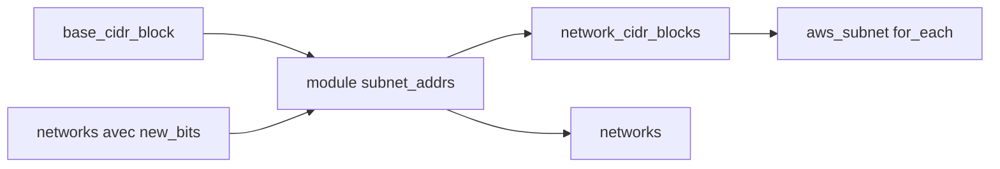

# hashicorp/terraform-cidr-subnets

> Module Terraform qui calcule des plages de sous-réseaux consécutives sous un bloc CIDR, pour l'infra cloud.

## Le problème
Découper un bloc d'adresses à la main provoque des chevauchements et des renumérotations accidentelles.

## Ce que ça fait vraiment
On donne un `base_cidr_block` et une liste de réseaux avec `new_bits`. Le module attribue des blocs consécutifs et renvoie `network_cidr_blocks` (map par nom) ou `networks` (liste ordonnée). Mettre un nom à `null` réserve l'espace d'un réseau obsolète sans décaler les autres.

## Comment c'est branché
Schéma simplifié d'après la fiche, sans diagramme fourni.



## Essayer
```hcl
module "subnet_addrs" {
  source = "hashicorp/subnets/cidr"
  base_cidr_block = "10.0.0.0/8"
  networks = [
    { name = "foo", new_bits = 8 },
    { name = "bar", new_bits = 8 },
  ]
}
```

## Coût et pièges
Terraform 0.12.10 ou plus. Ne jamais retirer ni réordonner un réseau déjà déployé : vérifier avec `terraform plan`. Licence MPL-2.0, à copyleft faible.

## Ce que ce n'est pas
Ce n'est pas un module qui crée des VPC ou des sous-réseaux : il calcule seulement les adresses. Il ne gère pas IPv6 d'après le README.

## Alternatives
Aucune alternative nommée dans le README.

## Pour toi
Adopter si tu écris du Terraform réseau : petit, ciblé, et il évite les erreurs de découpage CIDR.

