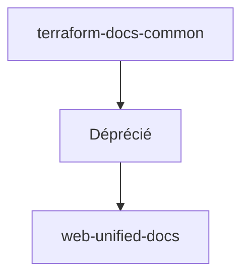

# hashicorp/terraform-docs-common

> Former repo of the public HCP Terraform documentation, now deprecated.

## The problem
Not documented: the README only describes the deprecation.

## What it actually does
The README only states that the repo is deprecated and points to `web-unified-docs` for editing the HCP Terraform documentation. Nothing else is described.

## How it is wired
Simplified diagram based on the fiche, no diagram provided.


## Trying it
```bash
# Aucune commande documentée.
```

## Cost and gotchas
No cost. Deprecated repo: do not contribute to it any more.

## What it is not
Not up-to-date documentation, nor something to read: go to the replacement repo.

## Alternatives
web-unified-docs: repo now used for the HCP Terraform documentation.

## For you
To ignore: deprecated repo, the reason being that its README redirects elsewhere.
