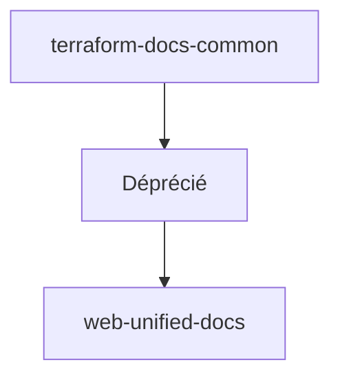

# hashicorp/terraform-docs-common

> Ancien dépôt de la documentation publique HCP Terraform, désormais déprécié.

## Le problème
Non documenté : le README ne décrit que la dépréciation.

## Ce que ça fait vraiment
Le README indique seulement que le dépôt est déprécié et renvoie vers `web-unified-docs` pour modifier la documentation HCP Terraform. Rien d'autre n'est décrit.

## Comment c'est branché
Schéma simplifié d'après la fiche, sans diagramme fourni.


## Essayer
```bash
# Aucune commande documentée.
```

## Coût et pièges
Aucun coût. Dépôt déprécié : ne plus y contribuer.

## Ce que ce n'est pas
Pas une documentation à jour ni à lire : il faut aller dans le dépôt de remplacement.

## Alternatives
web-unified-docs : dépôt désormais utilisé pour la documentation HCP Terraform.

## Pour toi
À ignorer : dépôt déprécié, la raison tient à son README qui redirige ailleurs.

