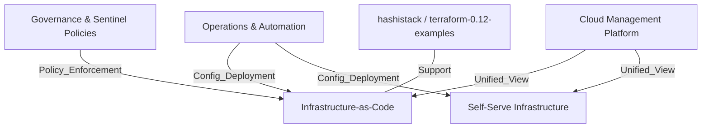

# hashicorp/terraform-guides

> Terraform examples, Sentinel policies and API scripts for Terraform Enterprise, published by HashiCorp.

## The problem
Getting started with Terraform Enterprise without a starting template: multi-cloud configurations, compliance rules and API automation have to be written from scratch.

## What it actually does
A reference repository, with no application code. It gathers Terraform configurations for VMs (AWS, Azure, GCP) and Kubernetes clusters (ACS, GKE), Sentinel governance policies, shell scripts that call the Terraform Enterprise REST API (workspace variables, policy import/export) and cloud management platform examples. Folders of 0.12 and 0.13 examples complete the set.

## How it is wired
Simplified diagram based on the diagram provided.



## Trying it
No command documented in the README: it only describes the folders. To try it, clone the repository and browse `infrastructure-as-code`.

```bash
git clone https://github.com/hashicorp/terraform-guides
cd terraform-guides/infrastructure-as-code
```

## Cost and gotchas
The examples assume Terraform Enterprise (paid offering) and cloud accounts billed to you. The `*gitignore*.tf` files are ignored by git, which is surprising.

## What it is not
Not a product or a library: examples to adapt. The README gives no tested version, and the 0.12 / 0.13 content is several Terraform generations old.

## Alternatives
No alternative named in the README.

## For you
Ignore for a data / MLOps profile without Terraform Enterprise: the examples are tied to a paid offering and can be found in the official documentation.
