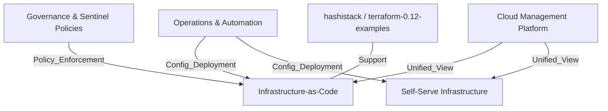

# hashicorp/terraform-guides

> Exemples Terraform, politiques Sentinel et scripts d'API pour Terraform Enterprise, publiés par HashiCorp.

## Le problème
Démarrer avec Terraform Enterprise sans modèle de départ : configurations multi-cloud, règles de conformité et automatisation de l'API sont à écrire de zéro.

## Ce que ça fait vraiment
Un dépôt de référence, sans code applicatif. Il regroupe des configurations Terraform pour des VM (AWS, Azure, GCP) et des clusters Kubernetes (ACS, GKE), des politiques Sentinel de gouvernance, des scripts shell qui appellent l'API REST de Terraform Enterprise (variables de workspace, import/export de politiques) et des exemples de plateforme de gestion cloud. Des dossiers d'exemples 0.12 et 0.13 complètent l'ensemble.

## Comment c'est branché
Schéma simplifié d'après le diagramme fourni.



## Essayer
Aucune commande documentée dans le README : il décrit seulement les dossiers. Pour l'essayer, cloner le dépôt et parcourir `infrastructure-as-code`.

```bash
git clone https://github.com/hashicorp/terraform-guides
cd terraform-guides/infrastructure-as-code
```

## Coût et pièges
Les exemples supposent Terraform Enterprise (offre payante) et des comptes cloud facturés à ta charge. Les fichiers `*gitignore*.tf` sont ignorés par git, ce qui surprend.

## Ce que ce n'est pas
Pas un produit ni une bibliothèque : des exemples à adapter. Le README ne donne aucune version testée, et le contenu 0.12 / 0.13 date de plusieurs générations de Terraform.

## Alternatives
Aucune alternative nommée dans le README.

## Pour toi
À ignorer pour un profil data / MLOps sans Terraform Enterprise : les exemples sont liés à une offre payante et se retrouvent dans la documentation officielle.

