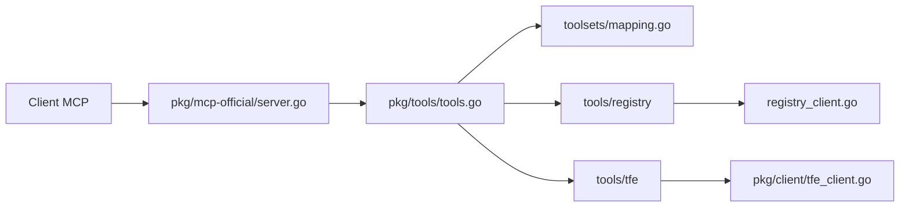

# hashicorp/terraform-mcp-server

> Official MCP server connecting an AI assistant to the Terraform registry and HCP Terraform, for IaC teams.

## The problem
An assistant writing Terraform invents providers or versions for lack of registry access, and cannot see your workspaces.

## What it actually does
Go server over stdio or Streamable HTTP, with two families of tools: public registry (search for providers, modules, policies, latest versions) and HCP Terraform / Terraform Enterprise (organizations, projects, workspaces, variables, runs). State-modifying operations require `ENABLE_TF_OPERATIONS`. In HTTP mode: TLS, CORS, rate limits, allowed-organizations list, per-user token, OpenTelemetry metrics.

## How it is wired


## Trying it
```bash
claude mcp add terraform -s user -t stdio -- docker run -i --rm hashicorp/terraform-mcp-server
docker run -p 8080:8080 --rm -e TRANSPORT_MODE=streamable-http -e TRANSPORT_HOST=0.0.0.0 hashicorp/terraform-mcp-server
```

## Cost and gotchas
Free; a `TFE_TOKEN` is only useful for HCP/TFE. Depending on the request, Terraform data is exposed to the LLM: the README forbids using it with an untrusted client. MPL-2.0 license, weak file-level copyleft.

## What it is not
Not a compliance guarantee: outputs are generated dynamically and must be reviewed. The modification tools are off by default.

## Alternatives
No alternative named in the README.

## For you
Adopt: tool vendor, documented security options and write operations disabled by default, useful for MLOps IaC.
