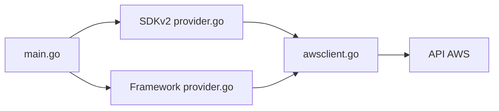

# hashicorp/terraform-provider-aws

> Terraform provider that manages AWS resources, for infrastructure teams.

## The problem
Describing and versioning AWS infrastructure as code rather than through the console.

## What it actually does
Minimal README (under 800 characters): it only lists the contribution guide, the quarterly roadmap, the FAQ and the tutorials. Judging from the code, the provider routes requests to service packages (SDKv2 and Plugin Framework) that call the AWS APIs.

## How it is wired

## Trying it
No command documented in the README.

## Cost and gotchas
The AWS resources created are billed by AWS. 3,577 open issues.

## What it is not
Not a standalone tool: it requires Terraform and an AWS account. The README documents neither installation nor usage.

## Alternatives
No alternative named in the README.

## For you
Worth adopting to provision MLOps on AWS (MPL-2.0, maintained by HashiCorp), but the README says nothing: you have to read the Terraform documentation.
