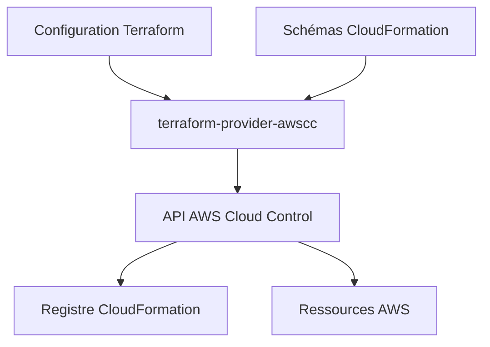

# hashicorp/terraform-provider-awscc

> Terraform provider that drives AWS resources through the Cloud Control API, generated from CloudFormation schemas.

## The problem
New AWS services reach Terraform late, because a provider has to be written by hand.

## What it actually does
Manages the full lifecycle of AWS resources through the Cloud Control API (create, read, update, delete, list). The provider is generated every week from the CloudFormation schemas, so it keeps up with new AWS features. A `role_arn` argument lets you use a service role and extend the duration of an operation up to 36 hours.

## How it is wired

## Trying it
No command in the README: it points to the Terraform Registry and two guides (Using the Provider, Provider development).

## Cost and gotchas
An AWS account and credentials are required; the AWS bill is yours. Only part of the CloudFormation resources are supported: some services have an old schema.

## What it is not
Not a full replacement for the classic AWS provider: coverage depends on Cloud Control. No frozen schemas: the weekly update can change resources.

## Alternatives
No alternative named in the README.

## For you
Keep an eye on it: useful for quickly testing new AWS services (including AI ones) in Terraform, but keep the classic AWS provider for most things.
