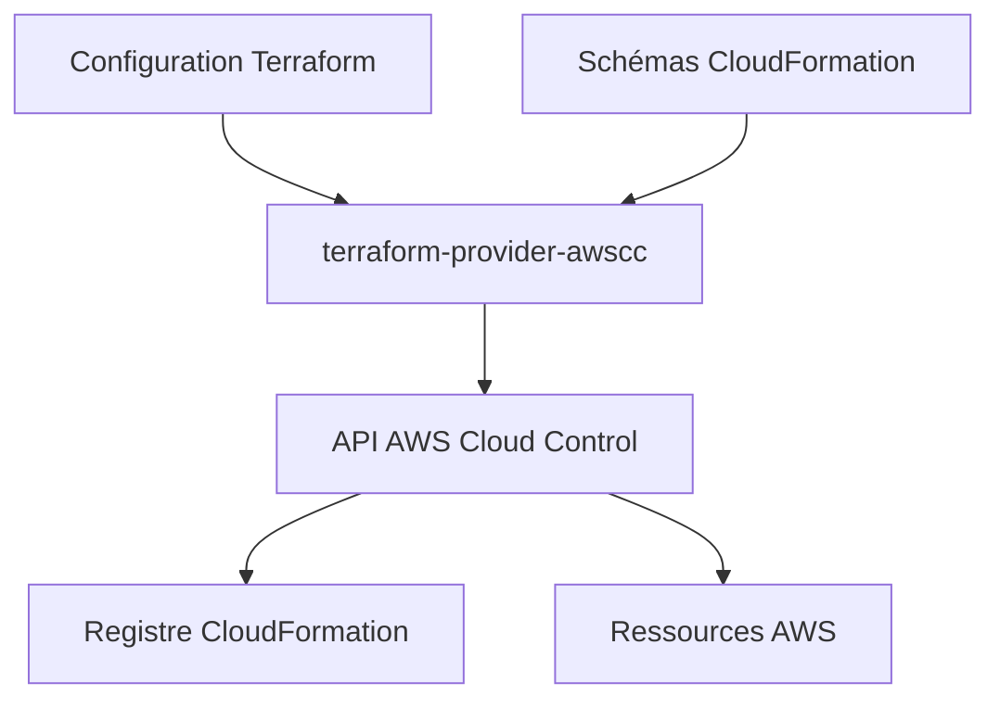

# hashicorp/terraform-provider-awscc

> Fournisseur Terraform qui pilote les ressources AWS via l'API Cloud Control, généré depuis les schémas CloudFormation.

## Le problème
Les nouveaux services AWS arrivent dans Terraform avec du retard, le temps d'écrire un fournisseur à la main.

## Ce que ça fait vraiment
Gère le cycle de vie complet de ressources AWS via l'API Cloud Control (créer, lire, modifier, supprimer, lister). Le fournisseur est généré chaque semaine depuis les schémas CloudFormation, donc il suit les nouveautés d'AWS. Un argument `role_arn` permet d'utiliser un rôle de service et d'allonger la durée d'une opération jusqu'à 36 heures.

## Comment c'est branché

## Essayer
Aucune commande dans le README : renvoi vers le Terraform Registry et deux guides (Using the Provider, Provider development).

## Coût et pièges
Compte AWS et identifiants nécessaires ; la facture AWS est à ta charge. Seule une partie des ressources CloudFormation est supportée : certains services ont un ancien schéma.

## Ce que ce n'est pas
Pas un remplaçant complet du fournisseur AWS classique : la couverture dépend de Cloud Control. Pas de schémas figés : la mise à jour hebdomadaire peut changer les ressources.

## Alternatives
Aucune alternative nommée dans le README.

## Pour toi
Surveiller : utile pour tester vite de nouveaux services AWS (y compris IA) en Terraform, mais garde le fournisseur AWS classique pour l'essentiel.

