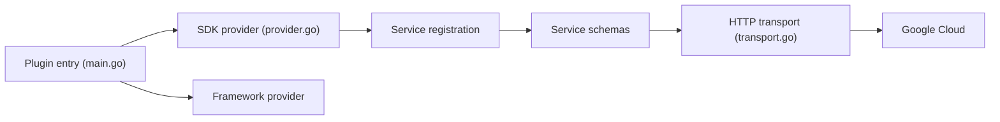

# hashicorp/terraform-provider-google

> Official Terraform plugin to manage Google Cloud resources, for infrastructure teams.

## The problem
Describing and versioning Google Cloud infrastructure as code rather than through the console.

## What it actually does
The provider registers resource and data source schemas per service and calls them through a common HTTP transport. It covers generally available features; the `google-beta` provider covers previews. It is jointly maintained by the Terraform teams at Google and HashiCorp. The repository is generated from magic-modules: direct changes are overwritten.

## How it is wired


## Trying it
```bash
terraform init -upgrade
```

## Cost and gotchas
The provider is free; resources created on Google Cloud are billed. It does not update itself.

## What it is not
Not the place to contribute: code is changed in magic-modules. 2,731 open issues.

## Alternatives
No alternative named in the README (`google-beta` provider for previews).

## For you
Adopt if your ML infrastructure runs on Google Cloud: it is the official way to describe it as code.
