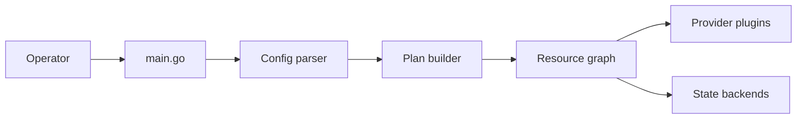

# hashicorp/terraform

> Infrastructure-as-code CLI: describe, plan and apply infrastructure changes, for ops and MLOps.

## The problem
Creating and modifying cloud resources by hand, with no plan or versioning, leads to drift and mistakes.

## What it actually does
Loads the configuration, builds a resource graph, produces an execution plan and then applies it.
Parallelizes independent resources; updates a state through backends.
Providers are plugins downloaded from the Terraform Registry; this repository contains only the core and the CLI.
Local, remote or Terraform Cloud operations.

## How it is wired


## Trying it
```bash
# Aucune commande documentée dans le README : renvoi vers le site et le guide de contribution.
```

## Cost and gotchas
Free locally; Terraform Cloud is a HashiCorp service. License present but not identified by GitHub: read it before commercial use.

## What it is not
Not the providers (separate repositories), not a machine configuration tool, no tutorial in the README.

## Alternatives
Not documented.

## For you
De facto standard for provisioning ML infrastructure; worth mastering, while checking the license.
