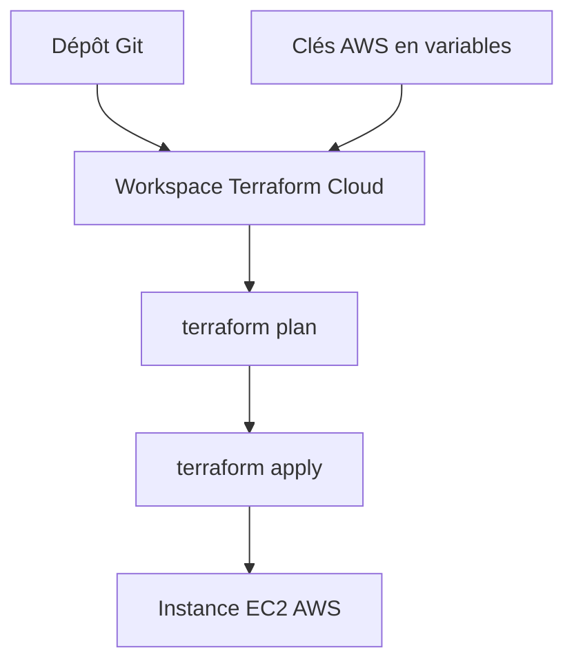

# hashicorp/tfc-guide-example

> Example Terraform configuration creating an EC2 instance, for the Terraform Cloud getting-started guide.

## The problem
A getting-started guide needs a small concrete configuration to link to a workspace.

## What it actually does
A Terraform configuration that creates an EC2 instance in your AWS account. Linked to a Terraform Cloud workspace, it triggers `terraform plan` and `terraform apply` on every push. The `AWS_ACCESS_KEY_ID` and `AWS_SECRET_ACCESS_KEY` keys are entered as environment variables of the workspace.

## How it is wired
Simplified diagram based on the sheet, no diagram provided.

## Trying it
No documented command: the README describes linking the repository to a Terraform Cloud workspace.

## Cost and gotchas
An AWS account and a Terraform Cloud account are required. The EC2 instance is billed by AWS, at your expense.

## What it is not
Not a reusable module: it is a one-off teaching example. Archived repository.

## Alternatives
None cited in the README.

## For you
Ignore: a single-use, archived example that teaches you nothing beyond the Terraform Cloud documentation.
