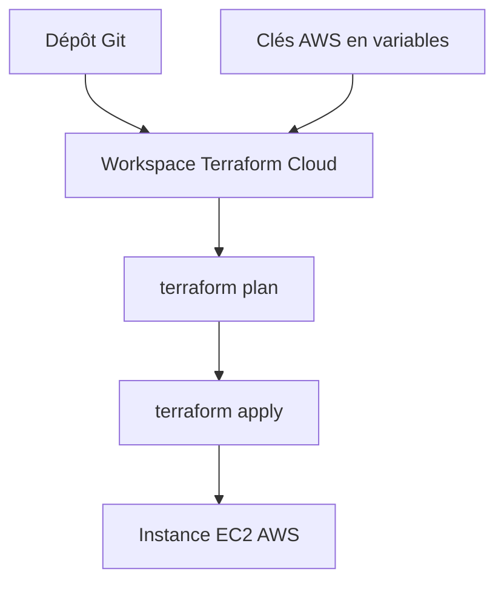

# hashicorp/tfc-guide-example

> Configuration Terraform d'exemple créant une instance EC2, pour le guide de démarrage Terraform Cloud.

## Le problème
Un guide de prise en main a besoin d'une petite configuration concrète à relier à un espace de travail.

## Ce que ça fait vraiment
Une configuration Terraform qui crée une instance EC2 dans ton compte AWS. Reliée à un workspace Terraform Cloud, elle déclenche `terraform plan` et `terraform apply` à chaque push. Les clés `AWS_ACCESS_KEY_ID` et `AWS_SECRET_ACCESS_KEY` se saisissent comme variables d'environnement du workspace.

## Comment c'est branché
Schéma simplifié d'après la fiche, sans diagramme fourni.

## Essayer
Aucune commande documentée : le README décrit la liaison du dépôt à un workspace Terraform Cloud.

## Coût et pièges
Compte AWS et compte Terraform Cloud requis. L'instance EC2 est facturée par AWS, à ta charge.

## Ce que ce n'est pas
Pas un module réutilisable : c'est un exemple pédagogique unique. Dépôt archivé.

## Alternatives
Aucune citée dans le README.

## Pour toi
À ignorer : exemple d'un seul usage, archivé, qui ne t'apprend rien de plus que la documentation Terraform Cloud.

