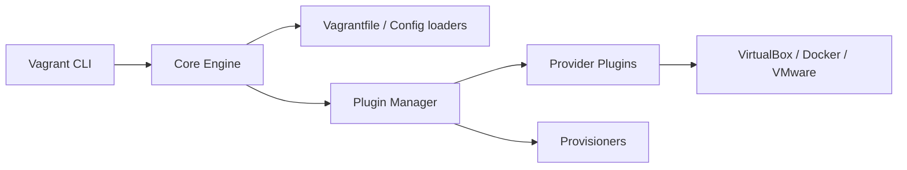

# hashicorp/vagrant

> Tool for building and distributing reproducible development environments on VMs or containers.

## The problem
Development environments differ from one machine to another and take a long time to reproduce.

## What it actually does
A `Vagrantfile` describes the machine; the command starts a provider (VirtualBox, VMware, Docker, AWS, OpenStack, Hyper-V) through a plugin system, then applies provisioners (shell, Chef, Puppet, Ansible) and synced folders. It requires `bsdtar` and `curl`. The README notes the deprecation of HCP Vagrant on November 2, 2026, with no effect on the CLI.

## How it is wired


## Trying it
```bash
vagrant init hashicorp/bionic64
vagrant up
```

## Cost and gotchas
Free; you need to install a hypervisor such as VirtualBox. License present but not identified by GitHub: to be checked (HashiCorp changed license elsewhere; not specified here).

## What it is not
Not a container tool nor an orchestrator. Not HCP Vagrant, which is being phased out.

## Alternatives
No alternative named in the README.

## For you
Ignore: for your data / MLOps environments, containers and environment managers are more direct than VMs.
