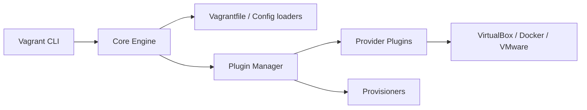

# hashicorp/vagrant

> Outil pour construire et distribuer des environnements de développement reproductibles sur VM ou conteneurs.

## Le problème
Les environnements de développement diffèrent d'une machine à l'autre et sont longs à reproduire.

## Ce que ça fait vraiment
Un fichier `Vagrantfile` décrit la machine ; la commande lance un fournisseur (VirtualBox, VMware, Docker, AWS, OpenStack, Hyper-V) via un système de plugins, puis applique des provisionneurs (shell, Chef, Puppet, Ansible) et des dossiers synchronisés. Il exige `bsdtar` et `curl`. Le README signale la dépréciation de HCP Vagrant au 2 novembre 2026, sans effet sur la CLI.

## Comment c'est branché


## Essayer
```bash
vagrant init hashicorp/bionic64
vagrant up
```

## Coût et pièges
Gratuit ; il faut installer un hyperviseur comme VirtualBox. Licence présente mais non identifiée par GitHub : à vérifier (HashiCorp a changé de licence ailleurs ; non précisé ici).

## Ce que ce n'est pas
Pas un outil de conteneurs ni d'orchestration. Pas HCP Vagrant, en cours d'abandon.

## Alternatives
Aucune alternative nommée dans le README.

## Pour toi
À ignorer : pour tes environnements data / MLOps, conteneurs et gestionnaires d'environnements sont plus directs que des VM.

