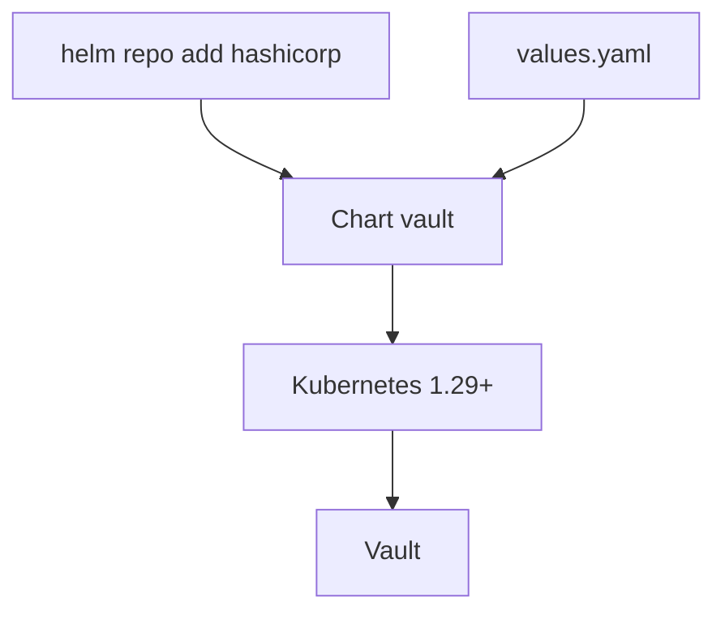

# hashicorp/vault-helm

> Official Helm chart to install and configure HashiCorp Vault on Kubernetes.

## The problem
Deploying Vault on Kubernetes by hand takes many manifests and settings.

## What it actually does
A Helm chart that installs Vault and handles several use cases depending on the values provided in `values.yaml`. The detailed documentation is on the Vault website, not in the README, which stays very short.

## How it is wired


## Trying it
```bash
helm repo add hashicorp https://helm.releases.hashicorp.com
helm install vault hashicorp/vault
```

## Cost and gotchas
Free, but you need Helm 3.6+ and Kubernetes 1.29+. Configuration (storage, high availability, security) is up to you.

## What it is not
It is not Vault itself, nor an operations guide: the README points to the online documentation. Many open issues (248).

## Alternatives
No alternative named in the README.

## For you
Worth watching: a reference if you have to manage secrets for MLOps pipelines on Kubernetes, otherwise useless.
