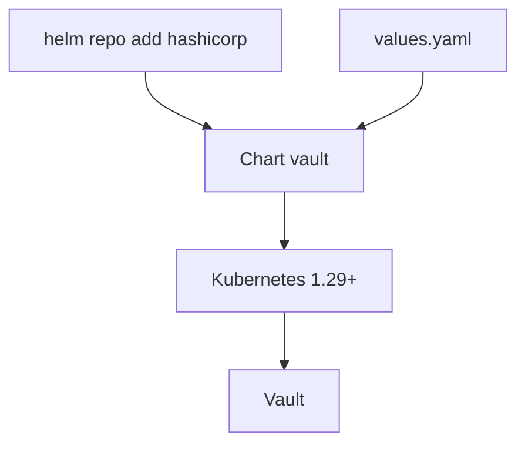

# hashicorp/vault-helm

> Chart Helm officiel pour installer et configurer HashiCorp Vault sur Kubernetes.

## Le problème
Déployer Vault sur Kubernetes à la main demande beaucoup de manifestes et de réglages.

## Ce que ça fait vraiment
Un chart Helm qui installe Vault et gère plusieurs cas d'usage selon les valeurs fournies dans `values.yaml`. La documentation détaillée est sur le site de Vault, pas dans le README, qui reste très court.

## Comment c'est branché


## Essayer
```bash
helm repo add hashicorp https://helm.releases.hashicorp.com
helm install vault hashicorp/vault
```

## Coût et pièges
Gratuit, mais il faut Helm 3.6+ et Kubernetes 1.29+. La configuration (stockage, haute disponibilité, sécurité) relève de toi.

## Ce que ce n'est pas
Ce n'est pas Vault lui-même, ni un guide d'exploitation : le README renvoie à la documentation en ligne. Beaucoup d'issues ouvertes (248).

## Alternatives
Aucune alternative nommée dans le README.

## Pour toi
Surveiller : référence si tu dois gérer des secrets pour des pipelines MLOps sur Kubernetes, sinon inutile.

