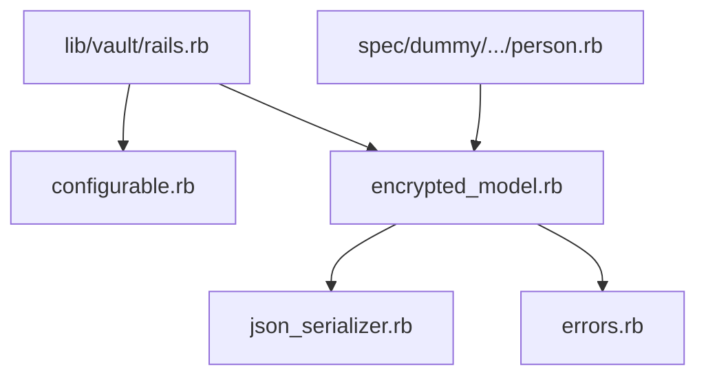

# hashicorp/vault-rails

> Rails plugin that encrypts ActiveRecord attributes with HashiCorp Vault's Transit engine.

## The problem
Storing sensitive data (card numbers, social security numbers) in clear text in the database exposes it in case of a leak.

## What it actually does
`vault_attribute` encrypts and decrypts a column via Transit. It supports custom keys, context-based derivation, default values, JSON serialization, lazy decryption and encryption without saving. Values cannot be searched with `where`.

## How it is wired
Diagram based on the code's diagram.


## Trying it
```bash
vault mount transit
vault write transit/keys/<key> create=1
```

## Cost and gotchas
Free, but you need a Vault server with the Transit backend. Ruby 3.2, Rails 7.0 and Vault 1.16. Changing the key, context or path makes existing data unreadable.

## What it is not
It is not database encryption: you cannot search on encrypted columns. It does not mount the backend for you.

## Alternatives
No alternative named in the README.

## For you
Ignore: Rails-specific, outside your data and MLOps domain.
