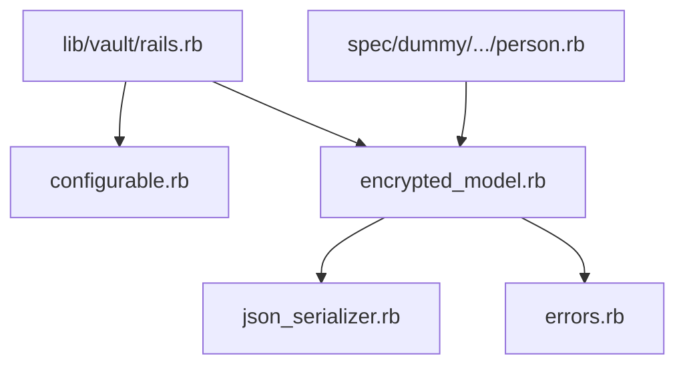

# hashicorp/vault-rails

> Plugin Rails qui chiffre des attributs ActiveRecord avec le moteur Transit de HashiCorp Vault.

## Le problème
Stocker des données sensibles (numéros de carte, sécurité sociale) en clair dans la base expose en cas de fuite.

## Ce que ça fait vraiment
`vault_attribute` chiffre et déchiffre une colonne via Transit. Il prend en charge les clés personnalisées, la dérivation par contexte, les valeurs par défaut, la sérialisation JSON, le déchiffrement paresseux et le chiffrement sans enregistrement. Les valeurs ne sont pas cherchables par `where`.

## Comment c'est branché
Schéma d'après le diagramme du code.


## Essayer
```bash
vault mount transit
vault write transit/keys/<key> create=1
```

## Coût et pièges
Gratuit, mais il faut un serveur Vault avec backend Transit. Ruby 3.2, Rails 7.0 et Vault 1.16. Changer clé, contexte ou chemin rend les données existantes illisibles.

## Ce que ce n'est pas
Ce n'est pas un chiffrement de base de données : on ne peut pas chercher sur les colonnes chiffrées. Il ne monte pas le backend à ta place.

## Alternatives
Aucune alternative nommée dans le README.

## Pour toi
À ignorer : spécifique à Rails, hors de ton domaine data et MLOps.

