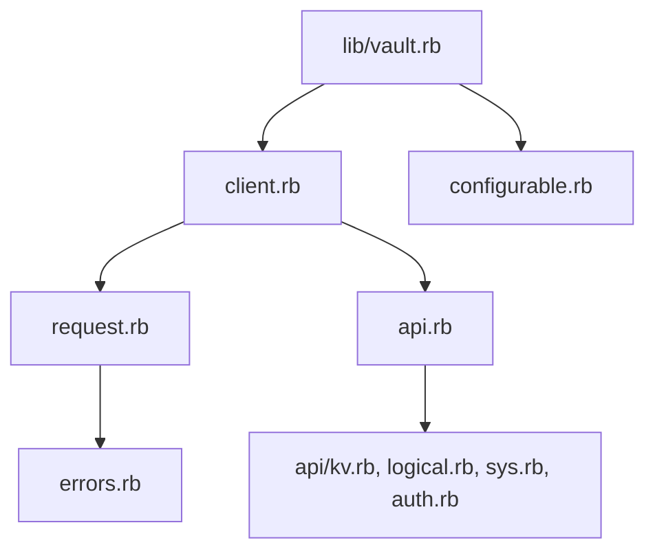

# hashicorp/vault-ruby

> Official Ruby client for talking to a HashiCorp Vault server: secrets, tokens and authentication.

## The problem
Calling Vault's HTTP API by hand, with TLS, authentication and retries, is repetitive.

## What it actually does
The gem exposes a `Vault` singleton and independent clients. It covers KV v1 and v2 secrets, the system (mounts, policies, seal status), tokens, response wrapping, transformation and several authentication methods (LDAP, AppRole, GitHub, AWS). `with_retries` retries on network or HTTP errors.

## How it is wired
Diagram based on the code diagram.


## Trying it
```bash
gem install vault
```

## Cost and gotchas
Free, but you need a Vault server to host. Ruby 3.1 or later. The license is MPL-2.0, with per-file copyleft.

## What it is not
It is not a Vault server. The master branch may contain unreleased features.

## Alternatives
No alternative named in the README.

## For you
Ignore: only if you use Ruby; for the secrets of an MLOps pipeline, a client in your own language is enough.
