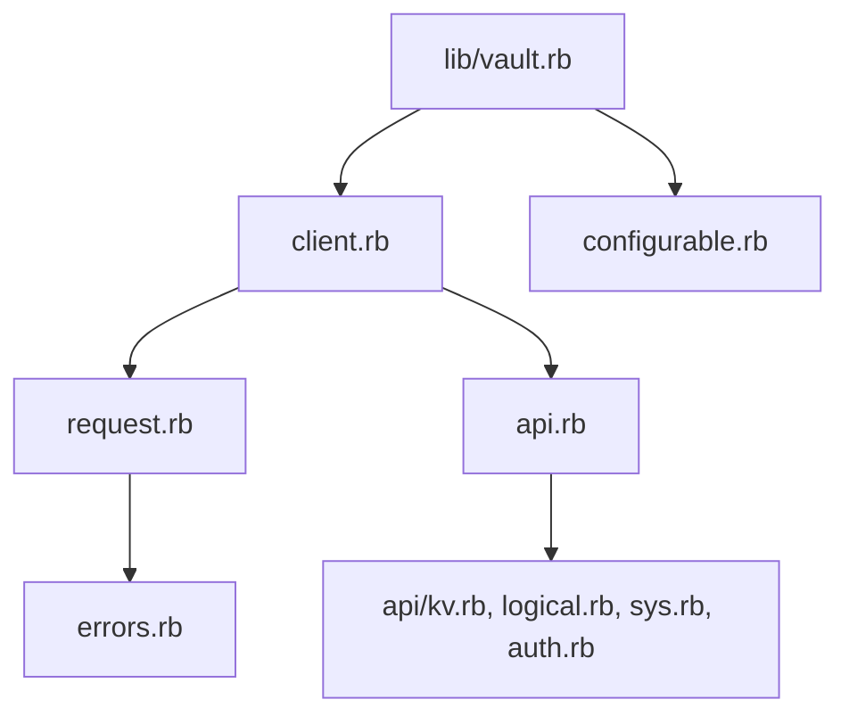

# hashicorp/vault-ruby

> Client Ruby officiel pour parler à un serveur HashiCorp Vault : secrets, jetons et authentification.

## Le problème
Appeler l'API HTTP de Vault à la main, avec TLS, authentification et reprises, est répétitif.

## Ce que ça fait vraiment
Le gem expose un singleton `Vault` et des clients indépendants. Il couvre les secrets KV v1 et v2, le système (montages, politiques, état de scellement), les jetons, l'encapsulation de réponse, la transformation et plusieurs méthodes d'authentification (LDAP, AppRole, GitHub, AWS). `with_retries` relance sur erreurs réseau ou HTTP.

## Comment c'est branché
Schéma d'après le diagramme du code.


## Essayer
```bash
gem install vault
```

## Coût et pièges
Gratuit, mais il faut un serveur Vault à héberger. Ruby 3.1 ou plus. La licence est MPL-2.0, à copyleft par fichier.

## Ce que ce n'est pas
Ce n'est pas un serveur Vault. La branche master peut contenir des fonctions non publiées.

## Alternatives
Aucune alternative nommée dans le README.

## Pour toi
À ignorer : seulement si tu as du Ruby ; pour les secrets d'un pipeline MLOps, un client dans ton langage suffit.

