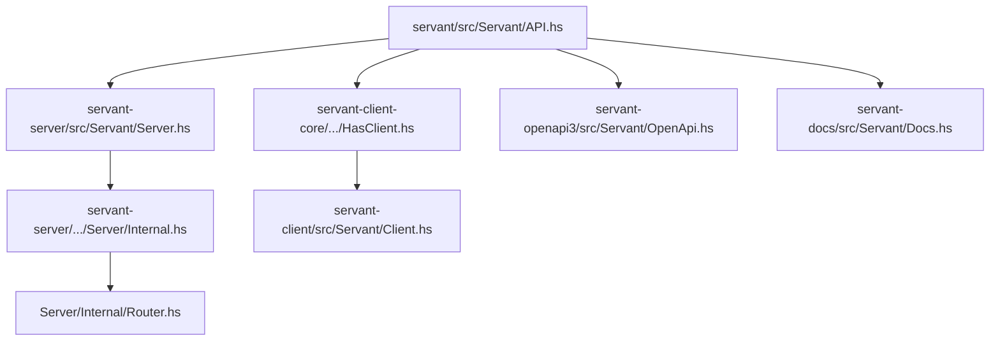

# haskell-servant/servant

> Haskell library that describes a web API as a type, to derive server and clients from it.

## The problem
The server, client and documentation of a web API quickly drift apart when each is written by hand.

## What it actually does
The API is a Haskell type (servant/src/Servant/API.hs). servant-server interprets it as a router, servant-client-core as an HTTP client. Other packages derive documentation, OpenAPI and authentication from it. The repository also publishes an entry in the TechEmpower benchmarks.

## How it is wired


## Trying it
```bash
nix develop
nix develop '#tutorial'
cabal new-build --enable-tests all
cabal new-test all
```

## Cost and gotchas
Free. You need a Haskell toolchain (GHC, cabal) or Nix; this requirement is missing from the prerequisites list. The license is not declared in the catalog.

## What it is not
Not a ready-to-use framework for Python or JavaScript: everything goes through Haskell's type system. The README is mostly a release and benchmarks guide, not a tutorial.

## Alternatives
No alternative named in the README (it only mentions warp and reitit for the benchmarks).

## For you
Ignore for a data / AI / MLOps profile: it is Haskell tooling, unrelated to Python or data pipelines.
