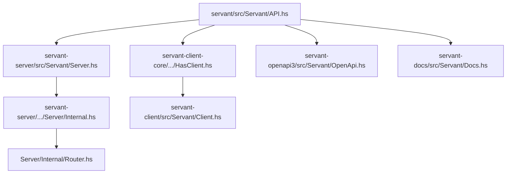

# haskell-servant/servant

> Bibliothèque Haskell qui décrit une API web comme un type, pour en dériver serveur et clients.

## Le problème
Serveur, client et documentation d'une API web dérivent vite l'un de l'autre quand chacun est écrit à la main.

## Ce que ça fait vraiment
L'API est un type Haskell (servant/src/Servant/API.hs). servant-server l'interprète en routeur, servant-client-core en client HTTP. D'autres paquets en tirent la documentation, OpenAPI et l'authentification. Le dépôt publie aussi une entrée aux benchmarks TechEmpower.

## Comment c'est branché


## Essayer
```bash
nix develop
nix develop '#tutorial'
cabal new-build --enable-tests all
cabal new-test all
```

## Coût et pièges
Gratuit. Il faut une chaîne Haskell (GHC, cabal) ou Nix ; ce besoin n'existe pas dans la liste des prérequis. La licence n'est pas déclarée dans le catalogue.

## Ce que ce n'est pas
Pas un framework prêt à l'emploi pour Python ou JavaScript : tout passe par le système de types de Haskell. Le README est surtout un guide de release et de benchmarks, pas un tutoriel.

## Alternatives
Aucune alternative nommée dans le README (il cite seulement warp et reitit pour les benchmarks).

## Pour toi
À ignorer pour un profil data / IA / MLOps : c'est de l'outillage Haskell, sans lien avec Python ni avec les pipelines de données.

