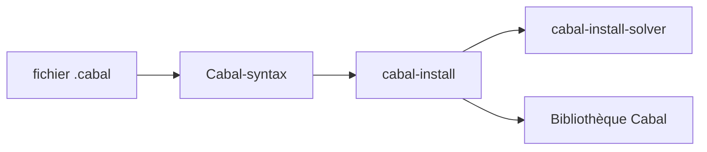

# haskell/cabal

> Library and `cabal-install` tool for building and installing Haskell packages.

## The problem
Describing, resolving dependencies for and compiling Haskell projects in a consistent way.

## What it actually does
- Repository of five packages: Cabal, Cabal-hooks, Cabal-syntax, cabal-install, cabal-install-solver.
- Three-year GHC support window.
- Recommended installation via GHCup; preview binaries (`cabal-head`) and self-update through `cabal install cabal-install`.
- Change proposals go through a dedicated repository.

## How it is wired


## Trying it
```bash
ghcup install --set cabal latest
cabal install cabal-install
cabal install --project-file=cabal.release.project cabal-install
```

## Cost and gotchas
Free. 1,984 open issues. A license is present but not identified by GitHub.

## What it is not
Not a manager for other languages. The bootstrap build requires a Python script.

## Alternatives
GHCup (cited as the preferred way to install).

## For you
Ignore: a Haskell tool unrelated to data / AI / MLOps.
