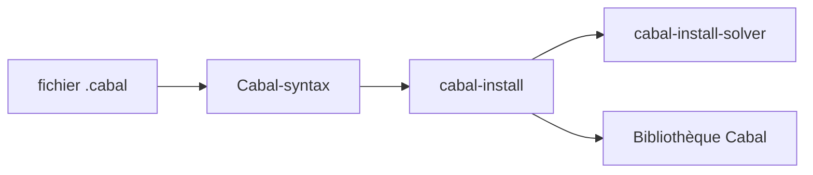

# haskell/cabal

> Bibliothèque et outil `cabal-install` pour construire et installer des paquets Haskell.

## Le problème
Décrire, résoudre les dépendances et compiler des projets Haskell de façon cohérente.

## Ce que ça fait vraiment
- Dépôt de cinq paquets : Cabal, Cabal-hooks, Cabal-syntax, cabal-install, cabal-install-solver.
- Fenêtre de support de GHC de trois ans.
- Installation recommandée via GHCup ; binaires de prévisualisation (`cabal-head`) et auto-mise à jour par `cabal install cabal-install`.
- Les propositions de changement passent par un dépôt dédié.

## Comment c'est branché


## Essayer
```bash
ghcup install --set cabal latest
cabal install cabal-install
cabal install --project-file=cabal.release.project cabal-install
```

## Coût et pièges
Gratuit. 1 984 issues ouvertes. Licence présente mais non identifiée par GitHub.

## Ce que ce n'est pas
Pas un gestionnaire pour d'autres langages. La build bootstrap exige un script Python.

## Alternatives
GHCup (cité comme voie préférée d'installation).

## Pour toi
À ignorer : outil Haskell sans rapport avec data / IA / MLOps.

