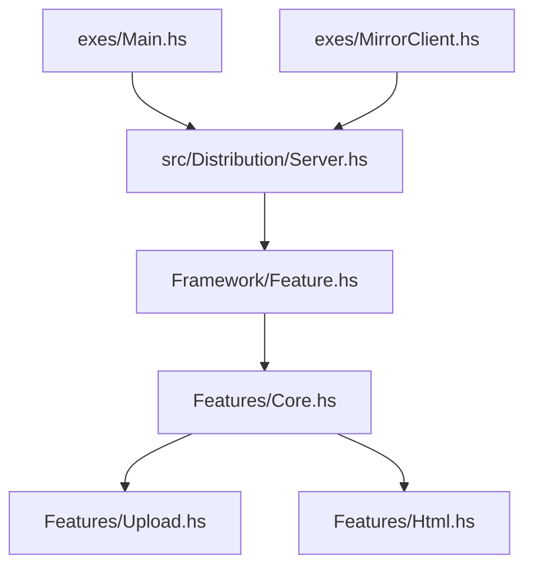

# haskell/hackage-server

> Code of the Hackage server, the central Haskell package repository, reusable for a private instance.

## The problem
Hosting your own Haskell package index, with accounts, uploads and mirroring.

## What it actually does
`Main.hs` starts the server, assembled from independent features (Core, Upload, Search, Html). Provides user groups (admins, trustees, mirrorers, uploaders), a TUF security infrastructure and a `hackage-mirror` client to copy packages from one server to another.

## How it is wired


## Trying it
```bash
nix run
# ou
cabal v2-run -- hackage-server init
cabal v2-run -- hackage-server run --static-dir=datafiles --state-dir=state \
  --base-uri=http://127.0.0.1:8080 --required-base-host-header=localhost:8080 \
  --user-content-uri=http://127.0.0.1:8080
```

## Cost and gotchas
Haskell toolchain (cabal) or Nix, plus `libgd`, `zlib`, `libbrotli-dev`. The example keys and the `admin`/`admin` account must be replaced before any deployment. 275 open issues.

## What it is not
Not a package client: it is the server. No link with Python/PyPI.

## Alternatives
No alternative named in the README.

## For you
Ignore: concerns the Haskell ecosystem, outside your data / AI / MLOps scope.
