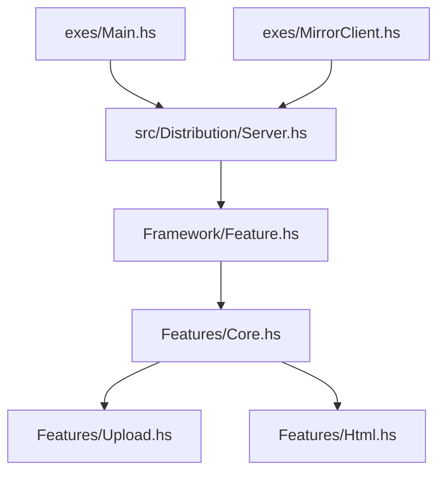

# haskell/hackage-server

> Code du serveur Hackage, le dépôt central de paquets Haskell, réutilisable pour une instance privée.

## Le problème
Héberger son propre index de paquets Haskell, avec comptes, téléversement et miroir.

## Ce que ça fait vraiment
`Main.hs` démarre le serveur, assemblé en features indépendantes (Core, Upload, Search, Html). Fournit des groupes d'utilisateurs (admins, trustees, mirrorers, uploaders), une infrastructure de sécurité TUF et un client `hackage-mirror` pour copier les paquets d'un serveur à l'autre.

## Comment c'est branché


## Essayer
```bash
nix run
# ou
cabal v2-run -- hackage-server init
cabal v2-run -- hackage-server run --static-dir=datafiles --state-dir=state \
  --base-uri=http://127.0.0.1:8080 --required-base-host-header=localhost:8080 \
  --user-content-uri=http://127.0.0.1:8080
```

## Coût et pièges
Toolchain Haskell (cabal) ou Nix, plus `libgd`, `zlib`, `libbrotli-dev`. Les clés d'exemple et le compte `admin`/`admin` sont à remplacer avant tout déploiement. 275 issues ouvertes.

## Ce que ce n'est pas
Pas un client de paquets : c'est le serveur. Aucun lien avec Python/PyPI.

## Alternatives
Aucune alternative nommée dans le README.

## Pour toi
Ignorer : concerne l'écosystème Haskell, hors de ton périmètre data / IA / MLOps.

