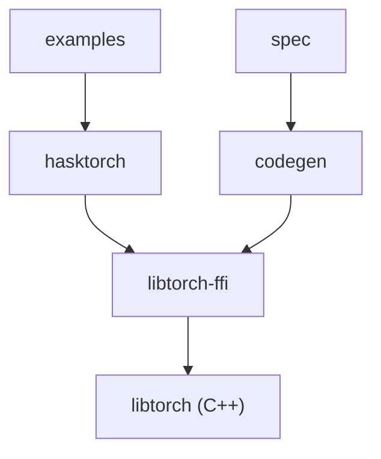

# hasktorch/hasktorch

> Haskell library for tensors and neural networks, on top of libtorch (PyTorch).

## The problem
Haskell enthusiasts want typed tensor computation without leaving the language or going through Python.

## What it actually does
It exposes PyTorch's C++ libraries in Haskell through generated FFI bindings. A `cabal build` downloads libtorch automatically, on CPU or CUDA (`LIBTORCH_CUDA_VERSION`). The provided examples include an MNIST CNN, and there are Nix builds and a JupyterLab Docker image.

## How it is wired


## Trying it
```bash
./setup-cabal.sh
cabal build hasktorch
cabal test hasktorch
cd examples
./datasets/download-mnist.sh
export DEVICE=cpu
cabal run static-mnist-cnn -- ./mnist/
```

## Cost and gotchas
Free; the first build downloads libtorch. GPU optional. The API is still changing, according to the README, and there are known problems moving tensors to CUDA.

## What it is not
Not a PyTorch replacement in production: the Haskell ecosystem is small. A license is present but not identified by GitHub.

## Alternatives
No alternative named in the README.

## For you
Watch: interesting for typed functional ML, but with no ecosystem equivalent to Python's, so reserve it for curiosity or Haskell teams.
