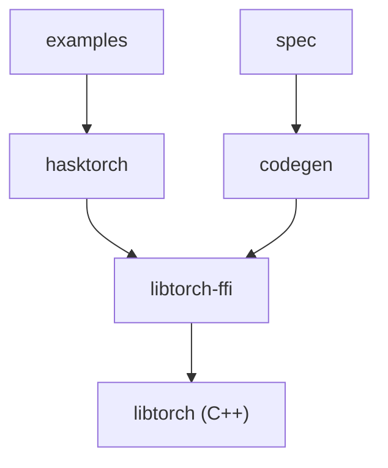

# hasktorch/hasktorch

> Bibliothèque Haskell de tenseurs et de réseaux de neurones, au-dessus de libtorch (PyTorch).

## Le problème
Les amateurs de Haskell veulent du calcul tensoriel typé sans quitter le langage ni passer par Python.

## Ce que ça fait vraiment
Elle expose en Haskell les bibliothèques C++ de PyTorch via des liaisons FFI générées. Un `cabal build` télécharge libtorch automatiquement, en CPU ou CUDA (`LIBTORCH_CUDA_VERSION`). Des exemples fournis incluent un CNN MNIST, et il existe des builds Nix et une image Docker JupyterLab.

## Comment c'est branché


## Essayer
```bash
./setup-cabal.sh
cabal build hasktorch
cabal test hasktorch
cd examples
./datasets/download-mnist.sh
export DEVICE=cpu
cabal run static-mnist-cnn -- ./mnist/
```

## Coût et pièges
Gratuit ; le premier build télécharge libtorch. GPU facultatif. API encore changeante, selon le README, et problèmes connus pour déplacer des tenseurs sur CUDA.

## Ce que ce n'est pas
Pas un remplaçant de PyTorch en production : écosystème Haskell restreint. Licence présente mais non identifiée par GitHub.

## Alternatives
Aucune alternative nommée dans le README.

## Pour toi
Surveiller : intéressant pour le ML fonctionnel typé, mais sans équivalent d'écosystème Python, donc à réserver à la curiosité ou à des équipes Haskell.

