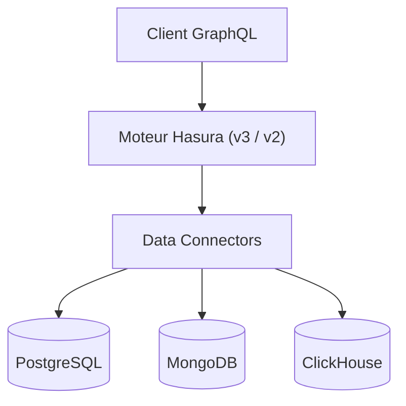

# hasura/graphql-engine

> Engine that exposes data sources (PostgreSQL, MongoDB, ClickHouse, SQL Server) through a single GraphQL API.

## The problem
Exposing several databases through a secure, composable API otherwise forces you to write a lot of access code.

## What it actually does
Monorepo with two versions: V3 (`v3` folder, the Hasura DDN engine, open data connectors, TypeScript, Python and Go SDKs) and V2 (current stable version, `v2` folder). Connectors are listed in the Connector Hub. The README mostly details cloning and licenses.

## How it is wired

Diagram inferred from the README (no diagram supplied).

## Trying it
```bash
git clone https://github.com/hasura/graphql-engine.git --depth 1
git clone --no-checkout https://github.com/hasura/graphql-engine.git --depth 1
cd graphql-engine
git sparse-checkout init --cone
git sparse-checkout set v3
git checkout @
```

## Cost and gotchas
Large repository (long history). V3 is tied to Hasura DDN, a hosted offering. The README speaks of a V3 license "intended to be" Apache-2.0.

## What it is not
Not a quick start: the README gives no launch command. The contents of `v2` other than `server`, `cli`, `console` are under MIT.

## Alternatives
None named in the README.

## For you
Watch: useful for exposing data to AI applications, but the README does not guide setup and V2/V3 are two products to choose between.
