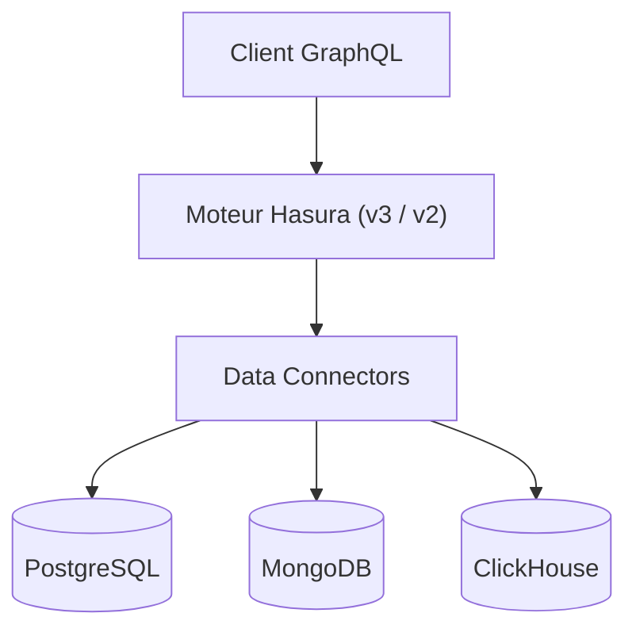

# hasura/graphql-engine

> Moteur qui expose des sources de données (PostgreSQL, MongoDB, ClickHouse, SQL Server) via une API GraphQL unique.

## Le problème
Exposer plusieurs bases par une API sécurisée et composable oblige sinon à écrire beaucoup de code d'accès.

## Ce que ça fait vraiment
Dépôt monorepo avec deux versions : V3 (dossier `v3`, moteur de Hasura DDN, connecteurs de données ouverts, SDK Typescript, Python, Go) et V2 (version stable actuelle, dossier `v2`). Les connecteurs sont listés dans le Connector Hub. Le README détaille surtout le clonage et les licences.

## Comment c'est branché

Schéma déduit du README (aucun diagramme fourni).

## Essayer
```bash
git clone https://github.com/hasura/graphql-engine.git --depth 1
git clone --no-checkout https://github.com/hasura/graphql-engine.git --depth 1
cd graphql-engine
git sparse-checkout init --cone
git sparse-checkout set v3
git checkout @
```

## Coût et pièges
Dépôt volumineux (historique long). V3 est lié à Hasura DDN, offre hébergée. Le README parle d'une licence V3 « destinée à » être Apache-2.0.

## Ce que ce n'est pas
Pas un quick start : le README ne donne pas de commande de lancement. Le contenu de `v2` hors `server`, `cli`, `console` est sous MIT.

## Alternatives
Aucune nommée dans le README.

## Pour toi
À surveiller : utile pour exposer des données à des applications IA, mais le README ne guide pas la mise en route et V2/V3 sont deux produits à départager.

