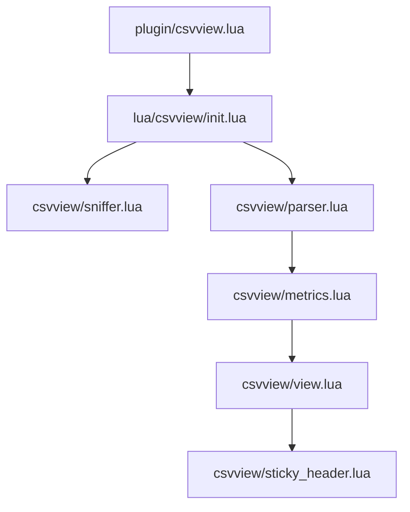

# hat0uma/csvview.nvim

> Neovim plugin to read and edit CSV / TSV files as a table using virtual text.

## The problem
Raw CSVs in an editor are unreadable: misaligned columns, headers lost when scrolling.

## What it actually does
Displays aligned columns via virtual text without modifying the file, with asynchronous parsing, automatic delimiter and header detection, sticky header, frozen columns, comment lines and text objects for fields. Two modes: `highlight` or `border`.

## How it is wired


## Trying it
```bash
# Dans Neovim :
# :CsvViewToggle
# :CsvViewToggle delimiter=, display_mode=border header_lnum=1
```

## Cost and gotchas
Free. Neovim 0.10 or later. Delimiters must be fixed strings, not regular expressions. Large files: reduce `async_chunksize` if the interface freezes.

## What it is not
Not a spreadsheet nor an analysis tool: no sorting or filtering for now (on the to-do list). No Excel reading.

## Alternatives
No alternative named in the README.

## For you
Useful from time to time if you inspect CSVs in Neovim; otherwise ignore, the value is editing comfort.
