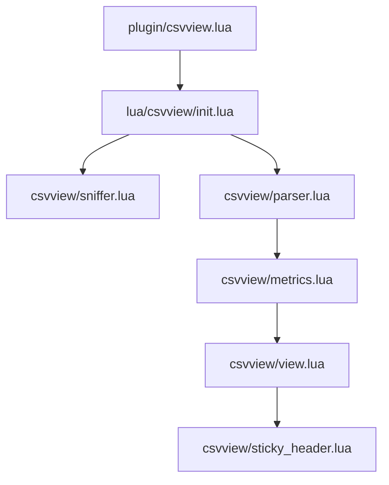

# hat0uma/csvview.nvim

> Plugin Neovim pour lire et éditer des fichiers CSV / TSV en tableau grâce au texte virtuel.

## Le problème
Les CSV bruts dans un éditeur sont illisibles : colonnes décalées, en-têtes perdus au défilement.

## Ce que ça fait vraiment
Affiche les colonnes alignées par texte virtuel sans modifier le fichier, avec analyse asynchrone, détection automatique du délimiteur et de l'en-tête, en-tête fixe, colonnes figées, lignes de commentaires et objets de texte pour les champs. Deux modes : `highlight` ou `border`.

## Comment c'est branché


## Essayer
```bash
# Dans Neovim :
# :CsvViewToggle
# :CsvViewToggle delimiter=, display_mode=border header_lnum=1
```

## Coût et pièges
Gratuit. Neovim 0.10 ou plus. Les délimiteurs doivent être des chaînes fixes, pas des expressions régulières. Gros fichiers : réduire `async_chunksize` si l'interface se fige.

## Ce que ce n'est pas
Pas un tableur ni un outil d'analyse : ni tri ni filtrage pour l'instant (dans la liste de tâches). Pas de lecture d'Excel.

## Alternatives
Aucune alternative nommée dans le README.

## Pour toi
Utile de temps en temps si tu inspectes des CSV dans Neovim ; sinon à ignorer, la valeur est le confort d'édition.

