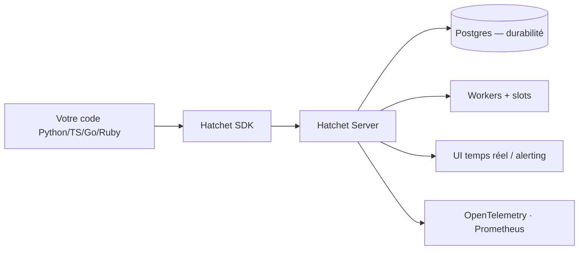

# hatchet-dev/hatchet

> Background task and durable workflow orchestration engine, backed by Postgres.

## The problem
Celery and BullMQ lose history as soon as the task is finished: impossible to replay a failure, no
intermediate state, and you have to hack together an admin tool to find your way at scale.

## What it actually does
Durable task queue: the whole execution history is persisted (up to a defined
retention). Unique tasks, cron, triggering by event or webhook. Durable tasks and DAGs
for long workflows, with pauses on durable sleep or waiting for an event. Priorities,
dynamic rate limits, fair scheduling by concurrency keys, slots per worker.
Real-time UI, OpenTelemetry, Prometheus metrics, native multi-tenancy. Python, TypeScript,
Go, Ruby SDKs.

## How it is wired


## Trying it
```bash
curl -fsSL https://install.hatchet.run/install.sh | bash
hatchet --version
hatchet server start
```

## Cost and gotchas
Self-hostable, but the local CLI requires Docker. Durability has an acknowledged price: tested up to
10,000 tasks/second, but more resource-hungry than Redis or RabbitMQ. Autoscaling,
multi-region, SSO and improved observability are reserved for Hatchet Cloud.

## What it is not
It is not a data orchestrator with connectors: the README explicitly points to
Airflow/Prefect/Dagster if you want ready-made integrations. It is not maximum
throughput: a Redis broker will go higher.

## Alternatives
- **Temporal / DBOS**: durable execution alone, without queue or DAG.
- **Celery / BullMQ**: simpler and faster if you do not need durability.
- **Airflow / Prefect / Dagster**: for data pipelines with ready-made connectors.

## For you
The right trade-off if your AI pipelines must resume after failure without losing context.
