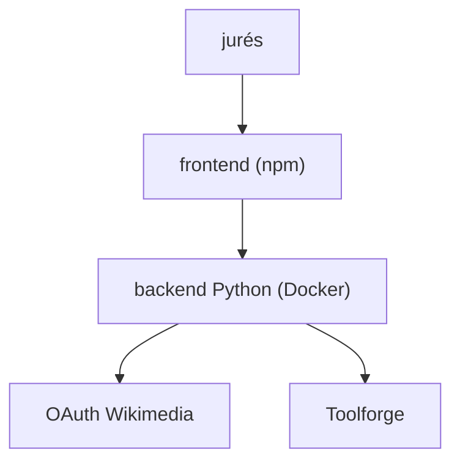

# hatnote/montage

> Round-based photo evaluation tool for Wiki Loves contests.

## The problem
Wiki Loves photography contests need a round-based evaluation process adapted to each group's rules.

## What it actually does
Montage provides a configurable round-based photo evaluation workflow. The Python backend runs under Docker, the frontend with npm. OAuth configuration is described in `dev.md` and deployment targets Toolforge. The README is short.

## How it is wired
Simplified diagram based on the sheet, no diagram provided.


## Trying it
```bash
git clone git@github.com:hatnote/montage.git && cd montage
make start
cd frontend && npm install && npm run dev
```

## Cost and gotchas
Docker, Node and a Wikimedia OAuth configuration (account required). 250 open issues.

## What it is not
Not a general-purpose image evaluation tool: it serves Wikimedia Foundation contests.

## Alternatives
No alternative named in the README.

## For you
Ignore: photo contest organization tool, unrelated to data or AI work.
