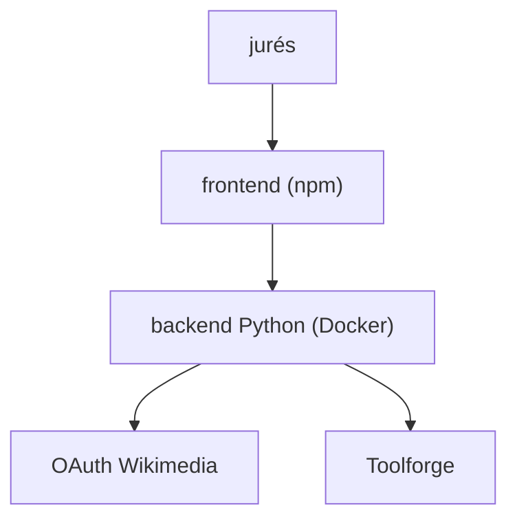

# hatnote/montage

> Outil d'évaluation de photos par tours pour les concours Wiki Loves.

## Le problème
Les concours de photographie Wiki Loves ont besoin d'un processus d'évaluation par tours adapté aux règles de chaque groupe.

## Ce que ça fait vraiment
Montage fournit un flux configurable d'évaluation de photos par tours. Le backend Python se lance sous Docker, le frontend avec npm. La configuration OAuth est décrite dans `dev.md` et le déploiement vise Toolforge. Le README est court.

## Comment c'est branché
Schéma simplifié d'après la fiche, sans diagramme fourni.


## Essayer
```bash
git clone git@github.com:hatnote/montage.git && cd montage
make start
cd frontend && npm install && npm run dev
```

## Coût et pièges
Docker, Node et une configuration OAuth Wikimedia (compte requis). 250 issues ouvertes.

## Ce que ce n'est pas
Pas un outil généraliste d'évaluation d'images : il sert aux concours de la fondation Wikimedia.

## Alternatives
Aucune alternative nommée dans le README.

## Pour toi
À ignorer : outil d'organisation de concours photo, sans lien avec un travail data ou IA.

