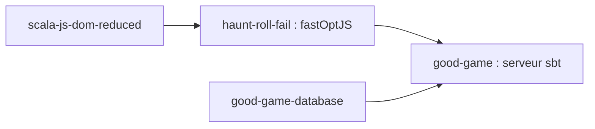

# haunt-roll-fail/haunt-roll-fail

> Board-game application in Scala, with a local server; build instructions only.

## The problem
Undocumented: the README only describes the build.

## What it actually does
The very short README says to publish `scala-js-dom-reduced` locally, build the client with `sbt fastOptJS`, then run the `good-game` server on port 7070 with a `good-game-database` database. Nothing about the games themselves.

## How it is wired
Simplified diagram based on the sheet, no diagram provided.


## Trying it
```bash
sbt publishLocal
sbt fastOptJS
sbt "run create ../good-game-database ../haunt-roll-fail http://localhost:7070 http://localhost:7070/hrf/ 7070"
sbt "run run ../good-game-database ../haunt-roll-fail http://localhost:7070 http://localhost:7070/hrf/ 7070"
```

## Cost and gotchas
Free. Scala and sbt are actually required (not listed), plus three sibling folders. Last push in December 2025.

## What it is not
Not usage documentation: we do not know which games exist. Not a data / AI tool.

## Alternatives
None named in the README.

## For you
Ignore: board games unrelated to data / AI work, and the README is too thin to judge.
