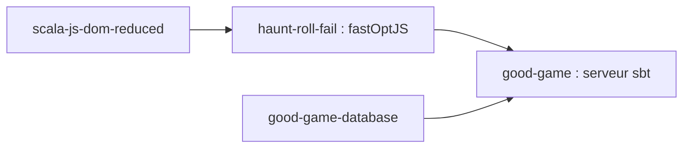

# haunt-roll-fail/haunt-roll-fail

> Application de jeux de plateau en Scala, avec serveur local ; instructions de compilation seules.

## Le problème
Non documenté : le README ne décrit que la compilation.

## Ce que ça fait vraiment
Le README, très court, indique de publier localement `scala-js-dom-reduced`, de compiler le client avec `sbt fastOptJS`, puis de lancer le serveur `good-game` sur le port 7070 avec une base `good-game-database`. Rien sur les jeux eux-mêmes.

## Comment c'est branché
Schéma simplifié d'après la fiche, sans diagramme fourni.


## Essayer
```bash
sbt publishLocal
sbt fastOptJS
sbt "run create ../good-game-database ../haunt-roll-fail http://localhost:7070 http://localhost:7070/hrf/ 7070"
sbt "run run ../good-game-database ../haunt-roll-fail http://localhost:7070 http://localhost:7070/hrf/ 7070"
```

## Coût et pièges
Gratuit. Scala et sbt sont requis en réalité (non listés), plus trois dossiers frères. Dernier push en décembre 2025.

## Ce que ce n'est pas
Pas une documentation d'usage : on ne sait pas quels jeux existent. Pas un outil data / IA.

## Alternatives
Aucune nommée dans le README.

## Pour toi
Ignorer : jeux de plateau sans rapport avec un travail data / IA, et README trop mince pour juger.

