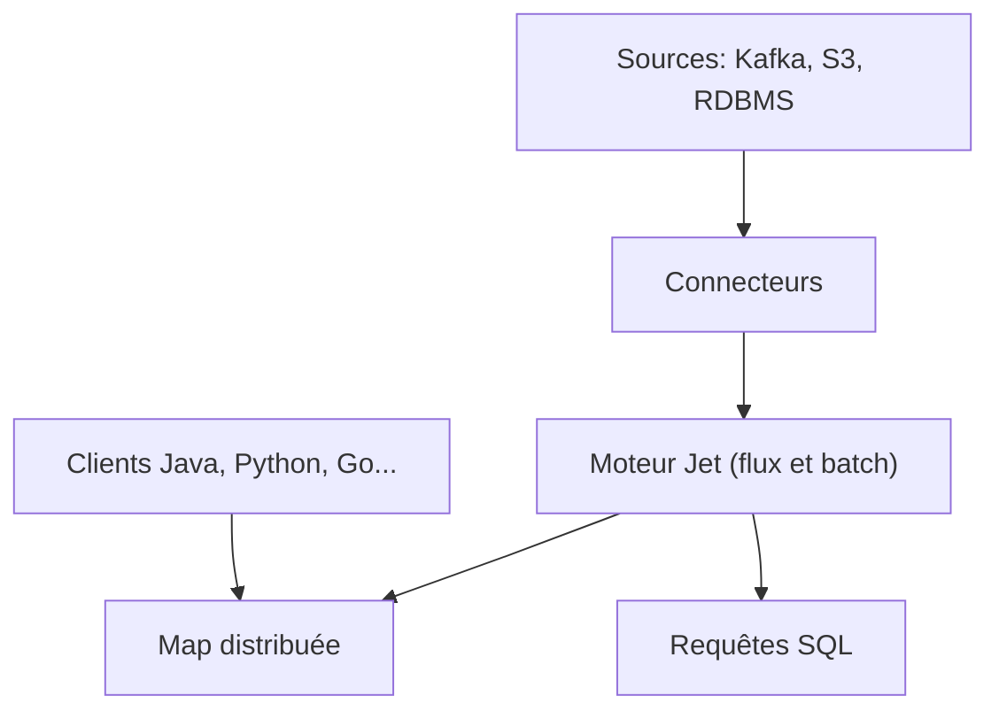

# hazelcast/hazelcast

> Real-time data platform in Java: distributed cache, stream processing and messaging.

## The problem
Applications need fast data access and stream processing without going through a database or a data lake.

## What it actually does
Provides a distributed data grid (key-value map with listeners), a Jet processing engine for stream or batch pipelines, SQL queries, queues and pub-sub. Connectors to Kafka, Hadoop, S3, relational databases. Clients in Java, Python, Node.js, .NET, C++ and Go. ML model deployment with Python integrated into pipelines.

## How it is wired
Simplified diagram based on the fiche, no diagram provided.



## Trying it
```bash
git pull origin master
./mvnw clean package -DskipTests -DskipITs
./mvnw test
```

## Cost and gotchas
Free to build; JDK 17 minimum. The test suite is very long and some tests require Docker. License present but not identified by GitHub: read it before any commercial use.

## What it is not
Not a simple cache library: it is a distributed platform to operate. The README's marketing text does not document installation, which is deferred to the external docs.

## Alternatives
No alternative named in the README.

## For you
Keep an eye on it: relevant for feature serving or stream enrichment, but check the license and the operating cost of a cluster.
