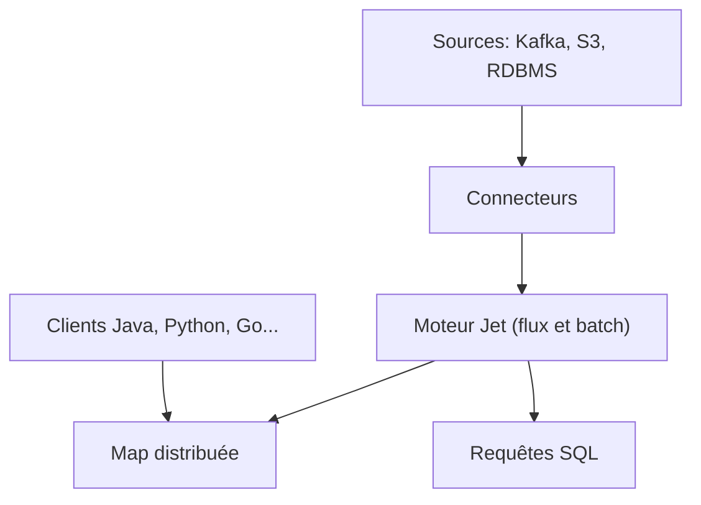

# hazelcast/hazelcast

> Plateforme de données temps réel en Java : cache distribué, traitement de flux et messagerie.

## Le problème
Des applications ont besoin d'accès rapide aux données et de traitement de flux sans passer par une base ou un lac de données.

## Ce que ça fait vraiment
Fournit une grille de données distribuée (map clé-valeur avec écouteurs), un moteur de traitement Jet pour pipelines de flux ou batch, des requêtes SQL, des files et du pub-sub. Connecteurs vers Kafka, Hadoop, S3, bases relationnelles. Clients en Java, Python, Node.js, .NET, C++ et Go. Déploiement de modèles ML avec Python intégré aux pipelines.

## Comment c'est branché
Schéma simplifié d'après la fiche, sans diagramme fourni.



## Essayer
```bash
git pull origin master
./mvnw clean package -DskipTests -DskipITs
./mvnw test
```

## Coût et pièges
Gratuit à construire ; JDK 17 minimum. La suite de tests est très longue et certains tests exigent Docker. Licence présente mais non identifiée par GitHub : à lire avant tout usage commercial.

## Ce que ce n'est pas
Pas une simple bibliothèque de cache : c'est une plateforme distribuée à exploiter. Le texte marketing du README ne documente pas l'installation, renvoyée à la doc externe.

## Alternatives
Aucune alternative nommée dans le README.

## Pour toi
À surveiller : pertinent pour du feature serving ou de l'enrichissement de flux, mais vérifie la licence et le coût d'exploitation d'un cluster.

