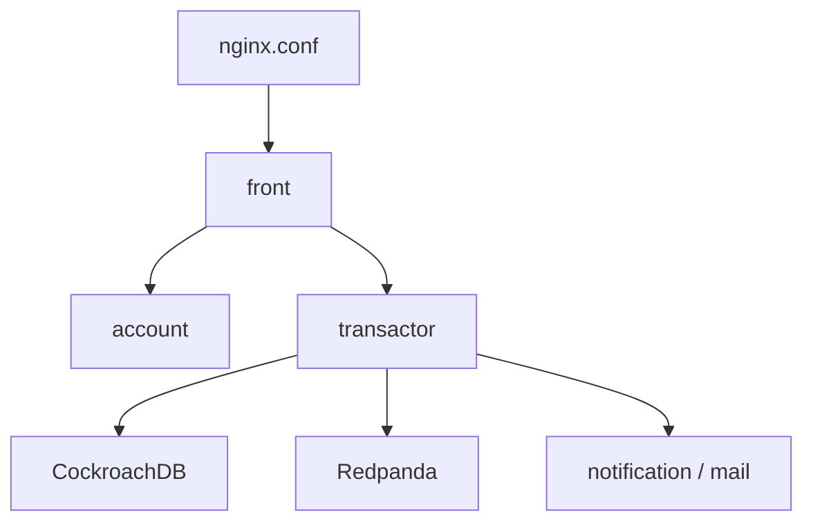

# hcengineering/huly-selfhost

> Docker compose files to self-host the Huly project management platform.

## The problem
Deploying Huly on your own server requires wiring about twenty services: database, message queue, storage, nginx.

## What it actually does
Provides `setup.sh`, a `compose.yaml`, the nginx config and a Kubernetes example. The README describes the optional services: email (SMTP or SES), push notifications (VAPID keys), audio and video calls (LiveKit), printing, export, AI assistant (OpenAI), Google calendar, OIDC, GitHub. `MIGRATION.md` guides upgrades. The provided README is truncated after the GitHub section.

## How it is wired
Simplified diagram based on the sheet, no diagram provided.


## Trying it
```bash
git clone https://github.com/hcengineering/huly-selfhost.git
cd huly-selfhost
./setup.sh --quick
docker compose down
```

## Cost and gotchas
Free, but 2 vCPU and 8 GB of RAM at minimum (16 GB recommended). The provided CockroachDB and Redpanda are not announced as production-ready. The AI, calls and calendar options require third-party accounts (OpenAI, LiveKit, Google, AWS).

## What it is not
Not the platform code (repository `hcengineering/platform`). Not a lightweight installation. Moving from 0.6.x to 0.7.x requires a dedicated migration.

## Alternatives
No alternative named in the README.

## For you
Worth watching: interesting if you want a self-hosted project tool, but heavy on resources and with no direct link to data or AI.
