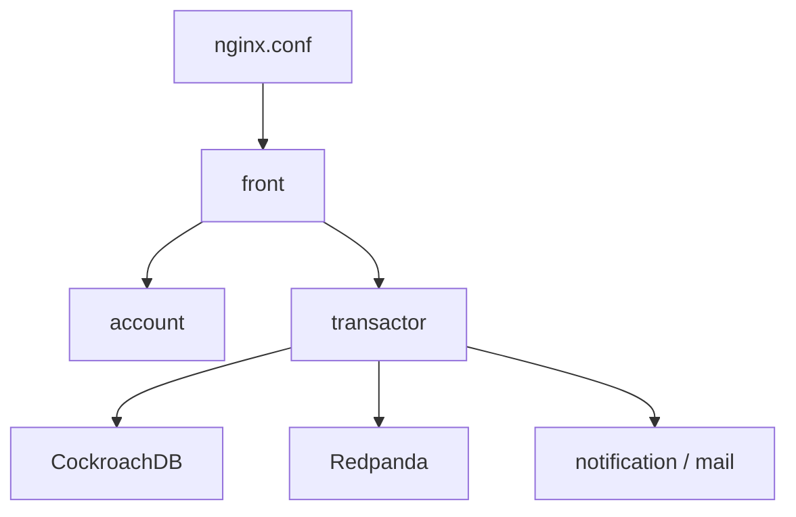

# hcengineering/huly-selfhost

> Fichiers docker compose pour héberger soi-même la plateforme Huly de gestion de projet.

## Le problème
Déployer Huly sur son propre serveur demande de câbler une vingtaine de services : base, file de messages, stockage, nginx.

## Ce que ça fait vraiment
Fournit `setup.sh`, un `compose.yaml`, la config nginx et un exemple Kubernetes. Le README décrit les services optionnels : courriel (SMTP ou SES), notifications push (clés VAPID), appels audio et vidéo (LiveKit), impression, export, assistant IA (OpenAI), calendrier Google, OIDC, GitHub. Le `MIGRATION.md` guide les mises à jour. Le README fourni est tronqué après la section GitHub.

## Comment c'est branché
Schéma simplifié d'après la fiche, sans diagramme fourni.


## Essayer
```bash
git clone https://github.com/hcengineering/huly-selfhost.git
cd huly-selfhost
./setup.sh --quick
docker compose down
```

## Coût et pièges
Gratuit, mais 2 vCPU et 8 Go de RAM au minimum (16 Go conseillés). CockroachDB et Redpanda fournis ne sont pas annoncés prêts pour la production. Les options IA, appels et calendrier demandent des comptes tiers (OpenAI, LiveKit, Google, AWS).

## Ce que ce n'est pas
Pas le code de la plateforme (dépôt `hcengineering/platform`). Pas une installation légère. Le passage de 0.6.x à 0.7.x impose une migration dédiée.

## Alternatives
Aucune alternative nommée dans le README.

## Pour toi
À surveiller : intéressant si tu veux un outil de projet auto-hébergé, mais lourd en ressources et sans lien direct avec la data ou l'IA.

