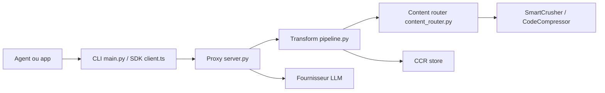

# headroomlabs-ai/headroom

> Local proxy and library that compress the context sent to LLMs, which use code agents.

## The problem
An agent repeatedly reviews tool usage logs, logs, and historical data at each turn: the fees charged do not result in any improvement in the response.

## What it actually does
A ContentRouter selects a compressor based on the type of content: SmartCrusher (JSON), CodeCompressor (AST), Kompress-v2-base (text). Only new content is compressed; the prefix remains the same to preserve the provider's cache. The original files are stored locally (CCR) and can be retrieved via `headroom_retrieve`. In addition, there is shared memory between agents, `headroom learn`, and a mode for reducing the number of output tokens (disabled by default).

## How it is wired


## Trying it
```bash
uv tool install --python 3.13 "headroom-ai[all]"
headroom wrap claude
headroom proxy --port 8787
headroom doctor
headroom dashboard
```

## Cost and gotchas
The service is free and open source; however, you are responsible for managing your own LLM provider key. An anonymized telemetry tag is enabled by default (can be disabled: `HEADROOM_BEACON=off`, `DO_NOT_TRACK=1`). Native wheels are announced for macOS Apple Silicon and Linux, while macOS Intel uses Docker.

## What it is not
Not a guaranteed win: the figures in the README (21 to 57% across four scenarios) are those of the author and are based on the repetitive nature of the tasks; the writing and dense output provide very little value. The Enterprise offering (automatic routing, security) is paid and is not included in the repository.

## Alternatives
- Compresr, Token Co.: API hosted, but the text goes to them and cannot be retrieved.
- OpenAI Compaction: built-in feature, limited to conversation history.

## For you
This is a good option if you're running code agents all day long: you can connect it without modifying the code, and then measure the savings it provides using the `headroom savings` feature.
